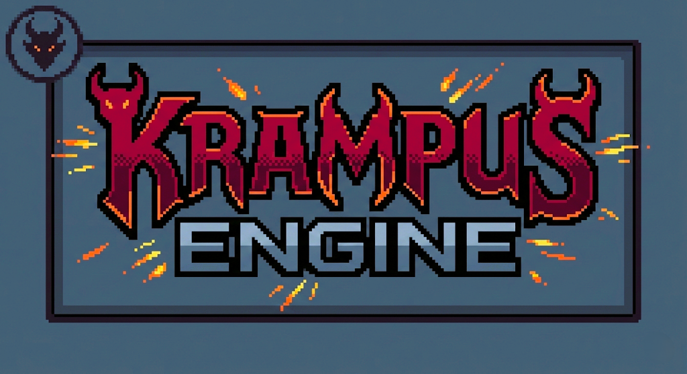
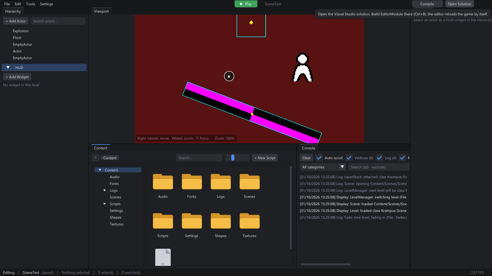
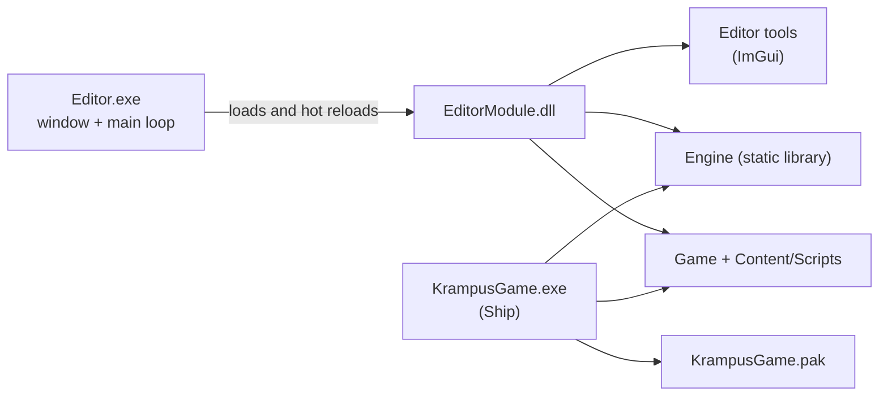

<h1 align="center">KrampusEngine</h1>

<p align="center">
  A 2D game engine and editor written from scratch in modern C++20.
</p>

<p align="center">
  
  
  
  
  
  
  
</p>

---

KrampusEngine is a personal engineering project: a complete 2D engine with its own editor, reflection system, scene format, physics integration, networking and packaging pipeline. The goal is to understand how a game engine works end to end by building every layer, with clear ownership rules and readable code rather than a long feature list.

The workflow is close to the one of a commercial engine: build scenes in the editor, write gameplay in C++ and see it hot reloaded in seconds, press **Play** to test, and package a standalone game for any Windows PC with one command.



## Table of contents

- [Highlights](#highlights)
- [The editor](#the-editor)
- [Engine features](#engine-features)
- [Getting started](#getting-started)
- [Writing gameplay code](#writing-gameplay-code)
- [Build configurations](#build-configurations)
- [Packaging a game](#packaging-a-game)
- [Architecture](#architecture)
- [Project structure](#project-structure)
- [Third-party libraries](#third-party-libraries)
- [Known limitations](#known-limitations)
- [Roadmap](#roadmap)
- [Author](#author)

## Highlights

- **Full editor** built with Dear ImGui: docked Viewport, Hierarchy, Inspector, Content browser and Console, with Play mode, undo / redo and a gizmo.
- **C++ hot reload**: the editor rebuilds the game module in the background and reloads it while keeping the scene and its unsaved changes.
- **Reflection** through a few macros (`KCOMPONENT`, `KPROPERTY`, `KFUNCTION`): properties appear in the Inspector, are saved in scenes and can be called from event lists, with no extra code.
- **box2d 3.1 physics** with boxes, circles and concave polygons drawn in a dedicated Shape Editor.
- **Dedicated tools**: Animation Editor, Animation Graph (state machine with parameters and conditions), Shape Editor and Network window.
- **Effects**: pooled particle system drawn in one call per emitter, and marks (burns, blood, paint) that stay on sprites.
- **Networking** on SFML (TCP + UDP): host / join / LAN discovery, messages, shared values, replicated actors and RPCs.
- **One-command packaging**: a standalone folder with the game, its content in a single `.pak` file and the C++ runtime.

## The editor

| Area | What it does |
|---|---|
| **Viewport** | Shows the game through an editor camera (right mouse to pan, wheel to zoom, `F` to focus). Click to select an actor by its sprite or physics shape; clicking again cycles through overlapping actors. Move / rotate / scale gizmo (`Q` `W` `E` `R`, `Shift` to snap). |
| **Hierarchy** | Actors and HUD widgets of the scene, parenting by drag and drop, search by name. |
| **Inspector** | Every reflected property of the selection and its components, with typed widgets (colors, textures, fonts, sounds, scenes, shapes, enums, flags, event lists). Add or remove components. |
| **Content browser** | Folder tree and thumbnails of `Content/`. Rename, move, delete, create scripts from a parent class, and drop files from the Windows Explorer to import them. |
| **Console** | Live log with filters by verbosity and category, text search and source locations. |
| **Play mode** | Runs the scene inside the editor. **Stop** restores the scene exactly as it was before Play. |
| **Undo / Redo** | Every edit is undoable (`Ctrl+Z` / `Ctrl+Y`); the editor asks before discarding unsaved changes. |
| **Compile** | `F7` builds the game module in the background and hot reloads it. **Open Solution** opens the generated Visual Studio solution with your new scripts already in it. |
| **Settings** | Engine settings (window, physics, time, audio, network, logging, packaging), editor preferences, rebindable shortcuts and a full color theme editor. |
| **Tools** | Animation Editor, Animation Graph, Shape Editor, Network window. |
| **Crash reporter** | On a crash, writes a report (call stack, minidump, log, last undo snapshot of the scene) and offers to restart the editor. |

Editor-only helpers never reach the game: the `BillboardComponent` gives clickable icons to invisible actors (spawn points, sounds, emitters), and debug outlines are drawn at a constant screen thickness at any zoom.

## Engine features

### Gameplay framework

- **Actors and components**: an actor owns a transform, children and a list of components; components add rendering, physics, input, audio, animation, networking or your own behavior.
- **Levels and scenes**: scenes are binary `.ka7` files made in the editor; the packaged game opens the start scene chosen in *Settings > Ship*.
- **Layers**: the engine loop runs a layer stack (level, fade, pause, splash, screenshots, editor overlay).
- **Timers and events**: timers managed per level, and a typed `Event<...>` system with safe re-entrancy and listener handles.
- **Settings**: grouped settings sections saved to `Content/Settings/EngineSettings.cfg` and edited in the Settings window.

### Reflection and scripting

- Classes declare themselves with `KCLASS`, `KACTOR`, `KCOMPONENT` and `KWIDGET`; members with `KPROPERTY` / `KPROPERTY_RANGE`; callable functions with `KFUNCTION`.
- Reflected classes can be spawned by name, appear in the editor menus and save their properties in scenes.
- **Event lists** (button presses, input bindings, network messages) call reflected functions on any actor without writing glue code.
- Safety checks catch invalid parents and duplicate class names when scripts are created or renamed.

### Rendering and graphics

- Sprites with rectangle, circle or **concave polygon** shapes, textures and texture rectangles.
- **Animation** from sprite sheets (rows, columns, wrapping), plus an **animation state machine** driven by Bool / Int / Float / Trigger parameters, conditions, an *Any* state and "wait for the end" transitions.
- **Particles**: eight presets (fire, smoke, sparks, explosion, snow, rain, magic, blood), emitter shapes, size / color / rotation over life, gravity, drag, velocity stretching, additive or alpha blending. Fixed pools, one draw call per emitter and view culling: about 0.2 ms of CPU time for 10,000 particles in Release.
- **Stains**: particles or code leave marks that stay on a sprite, follow its transform and are clipped to its shape by a shader; any number of marks costs a single extra draw call.
- Camera system with a default camera and a separate HUD view; labels and fonts; screen-space and world-space (diegetic) widgets.

### Physics

- **box2d 3.1.1** bodies: static, kinematic or dynamic, with damping, gravity scale, bullets, sleeping and collision filtering by channel.
- The physics shape follows the sprite (including its scale) or can be set as a custom box, circle or polygon.
- Concave polygons are split into convex pieces automatically.
- Explosions, center of mass and shape outlines in debug draw.

### Input

- Keyboard, mouse, mouse wheel, text input and gamepads (sticks, triggers, D-pad), all exposed as named events (`Space.Press`, `A.Release`, `MouseLeft.Press`...).
- `InputComponent` binds input events to reflected functions from the Inspector.

### Audio

- Sounds and music through SFML Audio.
- Spatial sound with a listener component, distance attenuation and listener cones.

### Networking

- Host / join by address or LAN discovery, player list with ping.
- Reliable (TCP) and fast (UDP) messages carrying typed values, shared key / value state kept by the host.
- `NetworkSyncComponent` replicates actors without code; RPCs call reflected functions on every machine.

### Tooling and debugging

- Threaded logger with verbosity levels, colored console, `log.txt` output and editor Console integration (Debug builds).
- Debug draw: lines, rectangles, circles, polygons and points; outlines keep the same on-screen thickness at any zoom.
- Save system with save file metadata.

## Getting started

### Requirements

- Windows 10 or 11, 64-bit
- [Visual Studio 2026](https://visualstudio.microsoft.com/) with the **Desktop development with C++** workload (MSVC 19.50, C++20)
- CMake 3.20 or newer (the one bundled with Visual Studio works)

All third-party libraries are included in [`ThirdParty/`](ThirdParty); nothing else has to be installed.

### Build and run

```bash
git clone https://github.com/Oronte/KrampusEngine.git
cd KrampusEngine
cmake --preset windows-vs2026
cmake --build --preset vs2026-debug
```

Then open `Build/vs2026/KrampusEngine.slnx` in Visual Studio and press **F5**: `Editor` is the startup project and runs from the repository root. To start it without Visual Studio, run `Bin/windows-x64/Debug/Editor/Editor.exe` with the repository root as the working directory.

> Run `cmake --preset windows-vs2026` again after adding or removing source files: the solution is generated from the files on disk.

### First steps

1. Open `Content/Scenes/SceneTest.ka7` (*File > Open Scene*) or create a new scene.
2. Add an actor (*Hierarchy > + Add Actor*), then components from the Inspector: `SpriteComponent`, `PhysicsComponent`, `ParticleComponent`...
3. Press **Play** to run the scene, **Stop** to get it back as it was.
4. Create a C++ script from the Content browser (*+ New Script*), edit it in Visual Studio, then press **F7**: the editor rebuilds and reloads it.

## Writing gameplay code

Scripts live in [`Content/Scripts`](Content/Scripts) and are compiled into the game module. A component only needs a few macros to be fully integrated in the editor:

```cpp
// MovementComponent.h
#pragma once
#include "Reflection/Reflection.h"

namespace Krampus
{
    class MovementComponent : public Component
    {
        KCOMPONENT(MovementComponent, Component)

    public:
        MovementComponent(Actor* _owner);

        KPROPERTY(Float, moveSpeed) = 1.f;      // shown in the Inspector, saved in scenes

        KFUNCTION(MoveLeft)                     // callable from event lists (input, buttons, network)
        void MoveLeft();
        KFUNCTION(MoveRight)
        void MoveRight();
    };
}
```

Once compiled, `MovementComponent` appears in *Add Component*, its `moveSpeed` is editable and saved, and `MoveLeft` / `MoveRight` can be bound to inputs from an `InputComponent` without any registration code.

The engine API is just as direct from code:

```cpp
// Spawn a one-shot effect that removes itself when it ends
GetLevel()->SpawnParticles(ParticlePreset::Explosion, _hitPosition);

// Burn every markable actor around the impact
StainComponent::StainAt(GetLevel(), _hitPosition, 40.f, Color(25, 20, 15, 180), StainStyle::Scorch);

// Drive the animation state machine
GetComponent<AnimationComponentSM>()->SetBool("isRunning", _speed > 1.f);
```

## Build configurations

| Configuration | Purpose | Logging | Optimized | Console window |
|---|---|:---:|:---:|:---:|
| **Debug** | Development, editor, hot reload | Yes | No | Yes |
| **Release** | Testing the game at full speed | No | Yes | Yes |
| **Ship** | The packaged game: static SFML, content read from the `.pak`, splash screen | No | Yes | No |

## Packaging a game

Choose the start scene in *Settings > Ship*, then use *File > Package Game* in the editor, or run:

```bat
Ship.bat
```

The result is a folder that runs on a PC with nothing installed:

```
Bin/windows-x64/Ship/Package/
├── KrampusGame.exe     the game (SFML linked statically)
├── KrampusGame.pak     every file of Content/ in one file (editor files, scripts, logs and saves left out)
└── *.dll               the Visual C++ runtime, deployed next to the exe
```

## Architecture



- **Engine** is a static library with no knowledge of the editor or of a specific game.
- **Game** holds the entry point and the scripts of `Content/Scripts`.
- **Editor** is split into a small host executable that owns the window and a DLL (engine + game + tools) that it reloads after each build, so gameplay code can change while the editor keeps running.
- **Ship** links the same engine and game into a standalone executable that reads its content from a pack.

Each frame, the engine polls the network and input, updates the layer stack (level, physics, timers, actors and components), then renders the world through the camera manager, the HUD and the overlays. Ownership is explicit: levels own actors, actors own components, and engine objects are held by smart pointers.

## Project structure

```
KrampusEngine/
├── CMake/          packaging and DLL copy scripts
├── Content/        everything the game loads
│   ├── Scenes/         .ka7 scenes
│   ├── Scripts/        C++ gameplay scripts (compiled into the game module)
│   ├── Shapes/         .kshape polygons made in the Shape Editor
│   ├── Textures/  Audio/  Fonts/  Settings/
│   └── _internal/      engine and editor files, hidden from the Content browser
├── Editor/         editor host (Main.cpp, crash reporter) and tools (Source/Tools)
├── Engine/         the engine library (Source/Actors, Components, Core, Graphics, Managers, Network, Reflection, Scene, UI...)
├── Game/           game entry point
├── Ship/           standalone game target and Package step
├── ThirdParty/     SFML, box2d, Dear ImGui + ImGui-SFML
└── Ship.bat        builds the packaged game
```

## Third-party libraries

| Library | Version | Use | License |
|---|---|---|---|
| [SFML](https://www.sfml-dev.org/) | 3.0.0 | Window, graphics, audio, network | zlib |
| [box2d](https://box2d.org/) | 3.1.1 | Rigid body physics | MIT |
| [Dear ImGui](https://github.com/ocornut/imgui) | 1.91.1 | Editor interface | MIT |
| [ImGui-SFML](https://github.com/SFML/imgui-sfml) | bundled | ImGui backend for SFML | MIT |

## Known limitations

- Windows only (x64, MSVC).
- 2D only.
- The editor is built in the **Debug** configuration; Release and Ship are meant for the game itself.
- The engine is single-threaded by design (the logger is the only worker thread), which keeps gameplay code deterministic and simple.
- Renaming an animation in the Animation Editor does not rename the transitions that use it; the Animation Graph lists them so they can be cleaned up.

## Roadmap

- Navigation mesh and pathfinding
- Procedural generation tools
- User shaders and post-processing
- A project launcher

## Author

Developed by **Oronte** — [github.com/Oronte](https://github.com/Oronte).

No license is provided yet: all rights are reserved by the author. Feel free to open an issue for questions or feedback.
